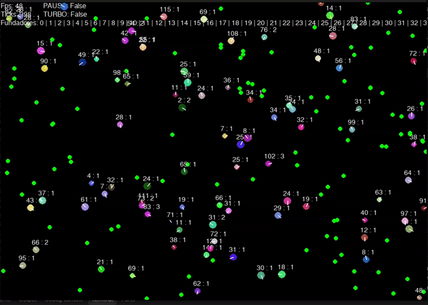
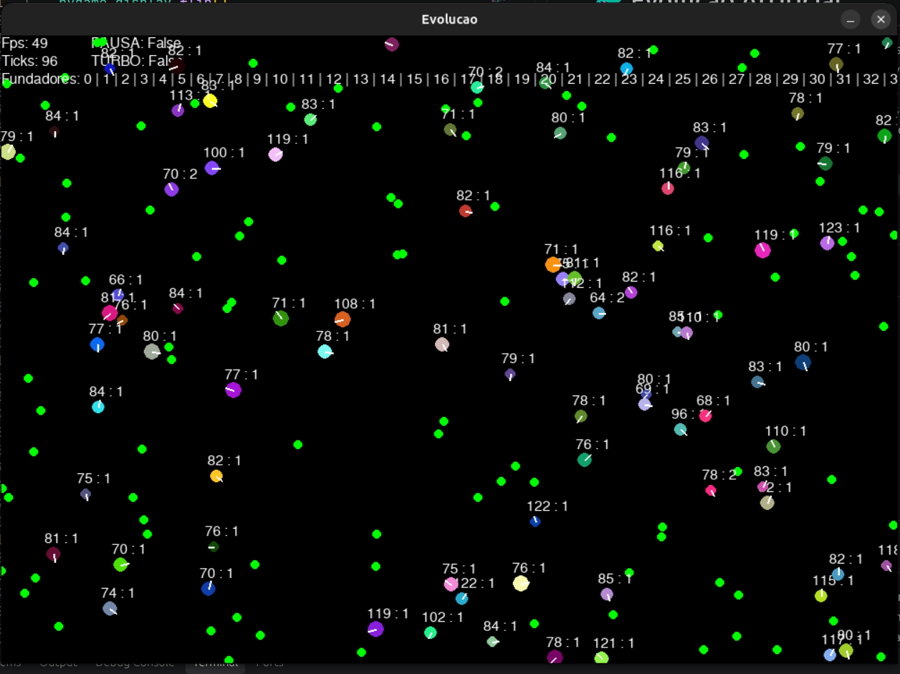
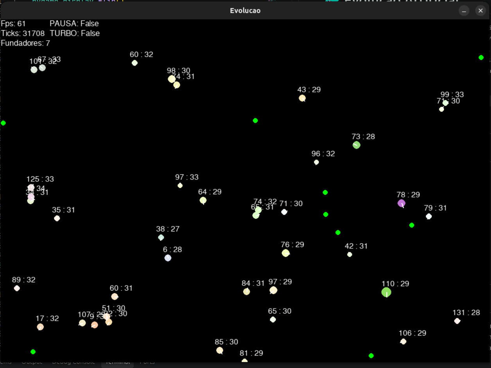
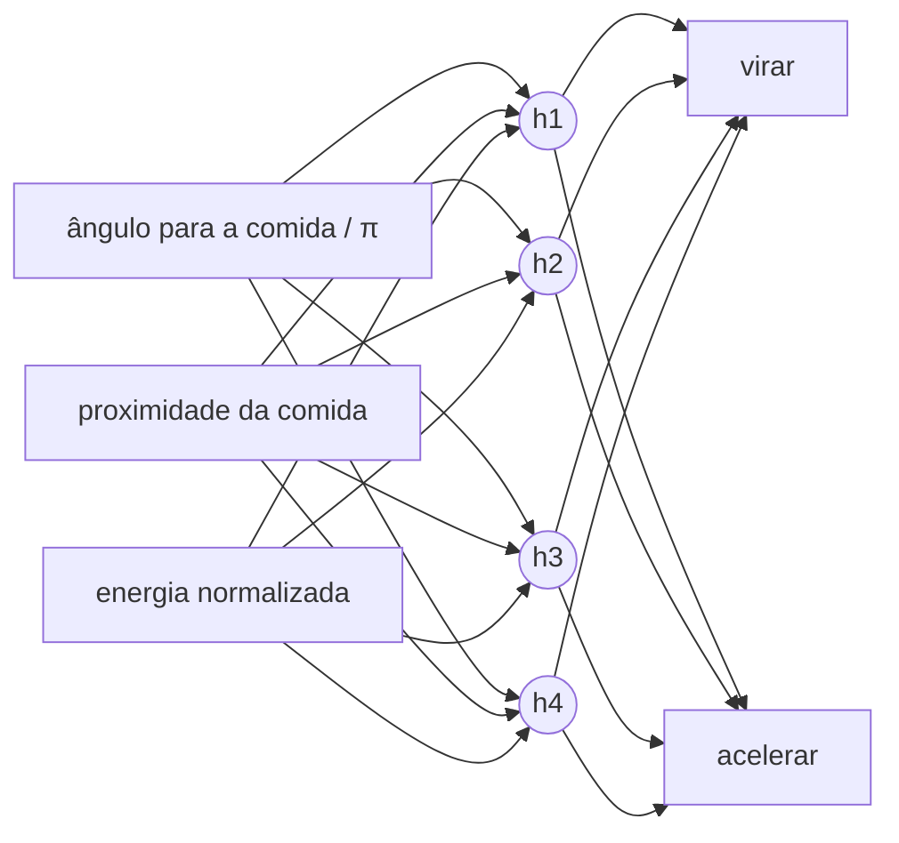

# 🧬 Evolução Artificial

Uma simulação 2D em Python onde pequenas criaturas, cada uma com um **cérebro neuronal** e um **genoma**, aprendem sozinhas a sobreviver. Ninguém lhes ensina a procurar comida: quem come o suficiente reproduz-se, os filhos herdam os genes com pequenas mutações, e ao fim de algumas dezenas de gerações aparecem criaturas que **viram para a comida e aceleram** — um comportamento que nunca foi programado.



[](https://github.com/UTILIZADOR/REPOSITORIO/actions/workflows/tests.yml)

---

## Índice

1. [O que faz](#-o-que-faz)
2. [Instalação e execução](#-instalação-e-execução)
3. [Controlos](#-controlos)
4. [Testes](#-testes)
5. [Estrutura do projeto](#-estrutura-do-projeto)
6. [Como funciona](#-como-funciona)
7. [Configuração](#️-configuração-srcconfigpy)
8. [Fases de desenvolvimento](#-fases-de-desenvolvimento)
9. [Observações](#-observações)
10. [Autoria](#-autoria)

---

## 🔄 Antes e depois

| Tick 0 — primeira geração | Tick 30 000 |
|:---:|:---:|
|  |  |
| 50 criaturas com cérebros e cores ao acaso, cada uma de uma linhagem diferente. Andam sem rumo: umas giram, outras ficam paradas, outras seguem a direito. | Gerações depois, a maioria das cores desapareceu: só restam descendentes de poucas fundadoras. As criaturas que sobreviveram viram para a comida e aceleram em direção a ela. |


---

## ✨ O que faz

- **Mundo toroidal** — sem paredes: quem sai por um lado entra pelo lado oposto.
- **Comida** que nasce a uma taxa fixa até um máximo.
- **Criaturas** com energia, que pagam para existir, andar e manter o corpo.
- **Genoma herdado** — tamanho, velocidade máxima, cor e cérebro — com **mutações gaussianas**.
- **Cérebro neuronal** (3 → 4 → 2) que recebe o que a criatura vê e decide para onde virar e quanto acelerar.
- **Neuroevolução** — não há treino nem gradientes: a seleção natural é o otimizador.
- **Linhagens** — cada criatura sabe de que fundadora original descende; o ecrã mostra quais as linhagens que ainda sobrevivem.
- **Modo turbo** para ver a evolução acontecer em segundos.

---

## 🚀 Instalação e execução

Requer **Python 3.10+** (testado com 3.12).

```bash
git clone https://github.com/UTILIZADOR/REPOSITORIO.git
cd REPOSITORIO

python3 -m venv .venv
source .venv/bin/activate          # Windows: .venv\Scripts\activate

pip install -r requirements.txt     # só para correr
# ou
pip install -r requirements-dev.txt # para correr e testar

python src/main.py
```

### Dependências

| Ficheiro | Pacotes |
|---|---|
| `requirements.txt` | `pygame`, `numpy`, `matplotlib` |
| `requirements-dev.txt` | tudo o anterior + `pytest` |

---

## 🎮 Controlos

| Tecla | Ação |
|---|---|
| `Espaço` | Pausa / retoma |
| `T` | Liga / desliga o modo turbo |
| `Esc` ou fechar a janela | Sair |

No ecrã aparecem os FPS, o tick atual, o estado da pausa e do turbo, a lista de **fundadoras com descendentes vivos** e, por cima de cada criatura, a sua `energia : geração`.

---

## 🧪 Testes

```bash
python -m pytest                                    # todos (≈ 2–3 min)
python -m pytest --ignore=tests/test_simulacao.py   # rápidos (≈ 15 s)
python -m pytest tests/test_simulacao.py -v         # só a simulação completa
```

Os testes são **determinísticos**: antes de cada teste, as sementes do `random` (corpo) e do `numpy` (cérebros) são fixadas em `tests/conftest.py`.

| Ficheiro | O que verifica |
|---|---|
| `test_geometria.py` | `wrap`, `delta` toroidal, `angulo_relativo`, `pitagoras` |
| `test_brain.py` | Formas das matrizes, fórmula do `pensar`, saídas em [−1, 1], mutação centrada no pai |
| `test_genome.py` | Mutação dentro dos limites, cor em inteiros, geração +1, herança do cérebro e da fundadora |
| `test_creature.py` | Virar, velocidade real, `agir`, andar, custo de energia, energia normalizada, reprodução |
| `test_world.py` | Comida, comer através das bordas, visão, entradas do cérebro, filhos no fim do tick, fundadoras |
| `test_state_box.py` | Pausa, turbo e número de ticks por frame |
| `test_main.py` | Teclas, `update` e `draw` (sem abrir janela) |
| `test_simulacao.py` | Checkpoints: a população não se extingue nem explode, há gerações, e **mais de 60 %** das criaturas aprendem a virar para a comida |

O workflow `.github/workflows/tests.yml` corre cada ficheiro de testes num job separado, em cada push e pull request.

---

## 📁 Estrutura do projeto

```
evolucao/
├── src/
│   ├── main.py          # janela pygame, ciclo principal, eventos e desenho
│   ├── config.py        # todos os parâmetros num só sítio
│   ├── state_box.py     # estado do programa: a correr, pausa, turbo
│   ├── world.py         # o mundo: comida, criaturas, visão, um tick de simulação
│   ├── creature.py      # corpo: virar, andar, energia, comer, reproduzir
│   ├── genome.py        # genes herdados e cópia mutada
│   ├── brain.py         # rede neuronal: criar ao acaso, pensar, mutar
│   ├── geometria.py     # contas no mundo toroidal: wrap, delta, ângulos
│   └── food.py          # uma comida (posição)
├── assets/
│   ├── images/
│   │   ├── inicio.png   # captura no tick 0
│   │   └── 30000.png    # captura no tick 30 000
│   └── videos/
│       └── simulacao.gif  # animação do topo do README
├── tests/               # testes pytest (ver secção Testes)
├── .github/workflows/
│   └── tests.yml        # integração contínua (GitHub Actions)
├── pytest.ini           # diz ao pytest para procurar módulos em src/
├── requirements.txt
├── requirements-dev.txt
└── README.md
```

### Quem trata de quê

| Classe | Responsabilidade |
|---|---|
| `State` | Controlo do programa. Não sabe nada da simulação. |
| `World` | Tem as listas de comida e criaturas. Decide quem vê, quem come, quem nasce e quem morre. |
| `Creature` | Estado da **vida** (posição, ângulo, energia, velocidade real). Age, mas nunca mexe nas listas do mundo. |
| `Genoma` | O que se **herda** (tamanho, velocidade máxima, cor, geração, cérebro, fundadora). Sabe criar uma cópia mutada de si próprio. |
| `Brain` | Os pesos da rede e as contas. Não sabe o que as entradas e saídas significam. |

---

## 🔬 Como funciona

### Um tick de simulação

Para cada criatura, por esta ordem:

```
sentir  →  pensar  →  agir  →  andar  →  pagar energia  →  comer  →  reproduzir
```

No fim do tick, as criaturas mortas são removidas e os filhos nascidos nesse tick entram na população (nunca durante o ciclo, para não saltar nem processar ninguém duas vezes).

### O cérebro



**saídas = tanh( W₂ · tanh( W₁ · entradas + b₁ ) + b₂ )**

São 3 × 4 + 4 + 4 × 2 + 2 = **26 genes** só no cérebro.

| Entrada | Cálculo | Escala | Sem comida à vista |
|---|---|---|---|
| Ângulo | ângulo relativo à comida mais próxima ÷ π | [−1, 1] (positivo = à direita) | 0 |
| Proximidade | 1 − distância ÷ raio de visão | [0, 1] (1 = colada) | 0 |
| Energia | 2 × energia ÷ limiar de reprodução − 1 | [−1, 1], presa a 1 | — |

| Saída | Uso |
|---|---|
| Virar ∈ [−1, 1] | ângulo += saída × `CREATURE_MAX_TURN` |
| Acelerar ∈ [−1, 1] | velocidade real = (saída + 1) / 2 × velocidade máxima do genoma |

### Energia

Em cada tick, cada criatura paga:

**custo = K_BASE + K1 · tamanho + K2 · velocidade_real² + K3 · velocidade_máxima²**

- **K_BASE** — custo de existir.
- **K1** — corpos maiores gastam mais (mas chegam mais longe para comer).
- **K2** — andar depressa custa ao quadrado; abrandar poupa energia.
- **K3** — "manutenção dos músculos": ter uma velocidade máxima alta custa mesmo parada. Sem isto, a evolução levaria a velocidade máxima ao limite, porque seria de graça.

### Reprodução e mutação

Quando a energia passa `REPRODUCAO_LIMIAR`, a criatura divide-se:

- o filho recebe `REPRODUCAO_PERCENTAGEM` da energia do pai;
- o pai fica com o resto, menos `REPRODUCAO_CUSTO`;
- o genoma do filho é uma **cópia mutada** do do pai:

| Gene | Mutação | Limites |
|---|---|---|
| Tamanho | gaussiana, σ = 5 % do raio base | [3, 25] |
| Velocidade máxima | gaussiana, σ = 5 % da velocidade base | [0,3; 10] |
| Cor (cada canal) | gaussiana, σ = 5 % de 255 | [0, 255], inteiros |
| Pesos do cérebro | gaussiana, σ = 0,1 (absoluto) | sem limites (a `tanh` trata disso) |
| Geração | +1 | — |
| Fundadora | igual à do pai | — |

---

## ⚙️ Configuração (`src/config.py`)

### Janela e ecrã

| Variável | Valor | Descrição |
|---|---|---|
| `TAMANHO_JANELA` | `(1000, 700)` | Tamanho da janela em pixéis |
| `COR_DE_FUNDO` | `(0, 0, 0)` | Cor de fundo (RGB) |
| `COR_DE_TEXT` | `(255, 255, 255)` | Cor do texto no ecrã |
| `TEXT_FONT` | `"Arial"` | Fonte do texto (se não existir, o pygame usa a por omissão) |
| `TEXT_SIZE` | `16` | Tamanho da fonte |
| `FPS` | `60` | Máximo de frames por segundo |

### Tempo

| Variável | Valor | Descrição |
|---|---|---|
| `TICK_PARADO` | `0` | Ticks por frame em pausa |
| `TICK_AVANCO` | `1` | Ticks por frame no modo normal |
| `TICK_AVANCO_TURBO` | `50` | Ticks por frame no modo turbo |

### Mundo e comida

| Variável | Valor | Descrição |
|---|---|---|
| `WORLD_SIZE` | `(1000, 700)` | Tamanho do mundo (pode diferir da janela) |
| `MAX_FOOD` | `100` | Máximo de comidas no mundo ao mesmo tempo |
| `INICIAL_AMOUNT_FOOD` | `100` | Comidas no início |
| `TAXA_FOOD_PER_TICK` | `0.3` | Comida que nasce por tick (em média) |
| `FOOD_ENERGY` | `40` | Energia que cada comida dá |
| `FOOD_RADIUS` | `5` | Raio da comida (desenho e contacto) |
| `FOOD_COLOR` | `(0, 255, 0)` | Cor da comida |

### Criaturas: corpo e energia

| Variável | Valor | Descrição |
|---|---|---|
| `INICIAL_AMOUNT_CREATURES` | `80` | Criaturas da primeira geração |
| `CREATURE_BASE_RADIUS` | `8` | Raio médio da primeira geração |
| `CREATURE_BASE_VELOCITY` | `3` | Velocidade máxima média da primeira geração |
| `CREATURE_VARIATION` | `0.2` | Variação inicial (± 20 %) do raio e da velocidade |
| `CREATURE_MAX_ENERGY` | `100` | Energia de referência |
| `CREATURE_BASE_ENERGY` | `100` | Energia com que nasce a primeira geração |
| `CREATURE_MAX_TURN` | `11°` (em radianos) | Viragem máxima por tick |
| `CREATURE_BASE_VISION` | `120` | Raio de visão em pixéis |
| `CREATURE_MIN_RADIUS` / `CREATURE_MAX_RADIUS` | `3` / `25` | Limites do gene do tamanho |
| `CREATURE_MIN_VELOCITY` / `CREATURE_MAX_VELOCITY` | `0.3` / `10` | Limites do gene da velocidade máxima |
| `CREATURE_K_BASE` | `0.07` | Custo fixo por tick |
| `CREATURE_K1` | `0.008` | Custo por unidade de tamanho |
| `CREATURE_K2` | `0.017` | Custo por velocidade real ao quadrado |
| `CREATURE_K3` | `K2 / 4` | Custo de manutenção por velocidade máxima ao quadrado |
| `RANGE_COR_BASE` | `(255, 255, 255)` | Máximo de cada canal na cor da primeira geração |
| `CREATURE_COLOR` | `(255, 0, 0)` | *Não usada atualmente* (a cor vem do genoma) |
| `CREATURE_DIRECTION_COLOR` | `(255, 255, 255)` | Cor do traço que mostra a direção |
| `CREATURE_DIRECTION_LARGURA` | `2` | Grossura desse traço |

### Reprodução e mutação

| Variável | Valor | Descrição |
|---|---|---|
| `REPRODUCAO_LIMIAR` | `150` | Energia a partir da qual a criatura se reproduz |
| `REPRODUCAO_PERCENTAGEM` | `0.5` | Fração da energia que vai para o filho |
| `REPRODUCAO_CUSTO` | `10` | Energia perdida em cada reprodução |
| `REPRODUCAO_DESVIO_PADRAO` | `0.05` | Força das mutações do corpo (fração da escala de cada gene) |

### Cérebro

| Variável | Valor | Descrição |
|---|---|---|
| `NEURO_ENTRADAS` | `3` | Entradas: ângulo, proximidade, energia (por esta ordem) |
| `NEURO_ESCONDIDA` | `4` | Neurónios na camada escondida |
| `NEURO_SAIDA` | `2` | Saídas: virar, acelerar (por esta ordem) |
| `NEURO_DESVIO_DE_PESOS` | `0.5` | Desvio-padrão dos pesos da primeira geração |
| `NEURO_DESVIO_MUTACAO` | `0.1` | Desvio-padrão (absoluto) da mutação dos pesos |

---

## 🗺️ Fases de desenvolvimento

### ✅ Fase 1 — O palco
Janela pygame e ciclo de jogo com **eventos → update → draw** bem separados. Pausa, modo turbo e contador de FPS. A lógica nunca depende do desenho, o que permite correr milhares de ticks por segundo.

### ✅ Fase 2 — O mundo e a comida
Classe `World` e comida a nascer a uma taxa fixa até um máximo. Geometria **toroidal**: `wrap` traz qualquer posição para dentro do mundo com `%`, e `delta` devolve sempre o vetor **mais curto** entre dois pontos, mesmo através das bordas. Primeiros testes e organização em `src/` + `tests/`.

### ✅ Fase 3 — Criaturas sem cérebro
Criaturas que andam ao acaso, comem quando tocam na comida (distância ao quadrado contra a soma dos raios ao quadrado, sem raízes) e pagam energia por existir, ser grandes e andar depressa. Sem reprodução, **morrem todas** — o resultado esperado.

### ✅ Fase 4 — Genes, filhos e mutações
Classe `Genoma` (composição: a criatura *tem* um genoma). Reprodução acima de um limiar, com divisão de energia e custo, e mutação gaussiana com limites por gene. Os filhos entram na população só no fim do tick. Com as três condições de Darwin (variação, hereditariedade, reprodução diferencial), a população passa a manter-se sozinha.

### ✅ Fase 5 — Um cérebro de 26 números
Classe `Brain` com uma rede 3 → 4 → 2 em `numpy`. As criaturas veem a comida mais próxima dentro de um raio, calculam o ângulo relativo e a proximidade, e o cérebro decide virar e acelerar. A velocidade passa a ser decidida a cada tick e o custo passa a ter uma parte de manutenção. Os pesos fazem parte do genoma e mutam: **neuroevolução**. Acrescentado o registo da **fundadora** de cada linhagem.


---

## 🔭 Observações

- **A evolução funciona.** Com cérebros ao acaso, cerca de 50 % das criaturas que veem comida viram para o lado certo. Ao fim de alguns milhares de ticks, esse valor sobe para **75–95 %**, sem que esse comportamento tenha sido programado.
- **Boleia genética.** Por volta da geração 80–100, a cor da população fica quase unânime. A cor não dá nenhuma vantagem, mas viaja no mesmo genoma de um cérebro bem-sucedido; uma só linhagem fundadora acaba por tomar conta da população.
- **Equilíbrio frágil no início.** Com os valores atuais, cerca de 1 em cada 10 sementes extingue-se antes de a evolução ter tempo de atuar, porque os cérebros iniciais são ao acaso. Subi `INICIAL_AMOUNT_CREATURES` de 50 para 80 para resolver.

---

## ✍️ Autoria

Todo o código da simulação, em `src/`, foi escrito por mim.

**Gerado pelo Claude:** este `README.md`, os testes em `tests/` e o workflow `.github/workflows/tests.yml`.
